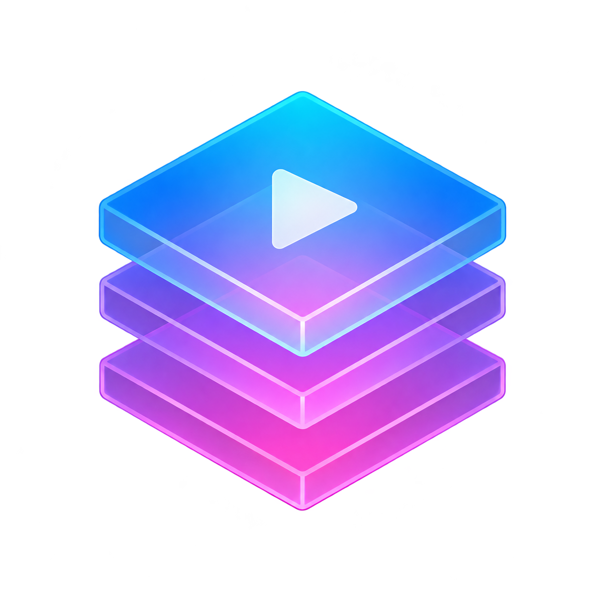

<div align="center">
  

  # NuvioHub

  **A curated directory for the modern streaming ecosystem**

  [](https://nuviohub.pages.dev)
  [](https://discord.gg/SYACcFKN8a)

  <p>
    NuvioHub brings together Nuvio apps, add-ons, debrid services, utilities,
    guides, and community resources in one easy-to-navigate hub.
  </p>

  <p>
    <a href="https://nuviohub.pages.dev">Open the website</a>
    &nbsp;&bull;&nbsp;
    <a href="https://github.com/jollran2005/NuvioHub/issues/new/choose">Submit a resource</a>
    &nbsp;&bull;&nbsp;
    <a href="https://discord.gg/SYACcFKN8a">Join the Discord</a>
  </p>
</div>

---

## Explore NuvioHub

| Section | Description |
| --- | --- |
| [Apps & Forks](https://nuviohub.pages.dev/core-apps) | Streaming clients and community forks for mobile, desktop, TV, and web. |
| [Add-ons & Plugins](https://nuviohub.pages.dev/addons) | Add-ons for VOD, live TV, sports, subtitles, catalogs, and stream discovery. |
| [Tools & Utilities](https://nuviohub.pages.dev/tools-utilities) | Setup assistants, account tools, collection managers, and formatters. |
| [Debrid & Usenet](https://nuviohub.pages.dev/debrid-services) | Debrid providers, multihosters, and Usenet resources. |
| [Community Guides](https://nuviohub.pages.dev/guides) | Official documentation, setup tutorials, and service status pages. |
| [Glossary](https://nuviohub.pages.dev/glossary) | Clear explanations of common terms and concepts. |

The directory is maintained as a practical, community-driven reference. Entries
link to official repositories, public documentation, configurators, or service
websites whenever possible.

## Run locally

### Prerequisites

- [Node.js](https://nodejs.org/) 18 or newer
- npm

### Development

```bash
git clone https://github.com/jollran2005/NuvioHub.git
cd NuvioHub
npm install
npm run docs:dev
```

The development site is available at `http://localhost:5173`.

### Production build

```bash
npm run docs:build
npm run docs:preview
```

NuvioHub is built with [VitePress](https://vitepress.dev/). The site content
and configuration live in [`docs/`](docs/).

## Contributing

NuvioHub stays useful through community feedback. You can help by:

- [Submitting a resource or correction on GitHub](https://github.com/jollran2005/NuvioHub/issues/new/choose)
- [Joining the Discord community](https://discord.gg/SYACcFKN8a)
- [Posting in the NuvioHub subreddit](https://www.reddit.com/r/NuvioHub/)

When contributing, please:

- Keep descriptions factual, concise, and neutral.
- Prefer official repositories and homepages over third-party mirrors.
- Check the directory and open issues for duplicates.
- Report resources that are offline, abandoned, or no longer relevant.
- Do not submit direct links to copyrighted media, torrent files, or infringing content.

## Disclaimer

NuvioHub does not host, store, index, or distribute any media files, torrent files, streams, or copyrighted content. All listings link strictly to official open-source repositories, public add-on configurators, community wikis, and legitimate service provider homepages.

## Links

- **Website:** [nuviohub.pages.dev](https://nuviohub.pages.dev)
- **Discord:** [Join the NuvioHub server](https://discord.gg/SYACcFKN8a)
- **Reddit:** [r/NuvioHub](https://www.reddit.com/r/NuvioHub/)
- **Repository:** [github.com/jollran2005/NuvioHub](https://github.com/jollran2005/NuvioHub)

## Support NuvioHub

<p align="center">
  <a href="https://ko-fi.com/jollran">
    
  </a>
</p>
